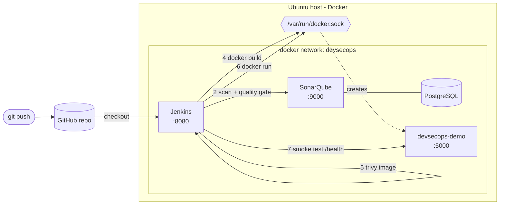

# DevSecOps: Secure CI/CD Pipeline with Jenkins, SonarQube & Trivy


A 100% free, local DevSecOps lab. One Ubuntu host runs everything with Docker Compose: **Jenkins** automates, **SonarQube** gates code quality (SAST), **Trivy** gates vulnerabilities, and the app is **deployed on the same host**. A GitHub Actions workflow (`ci.yaml`) re-tests the whole flow on every push.

## Architecture



### Pipeline stages

| # | Stage | Tool | Fails the build when |
|---|-------|------|----------------------|
| 1 | Lint & unit tests | ruff (incl. bandit rules), pytest, coverage | a rule or test fails |
| 2 | SonarQube analysis + quality gate | sonar-scanner | the quality gate is red |
| 3 | Filesystem scan | `trivy fs` (deps, secrets, Dockerfile misconfig) | HIGH/CRITICAL findings |
| 4 | Build image | `docker build` | build error |
| 5 | Image scan | `trivy image` (OS + Python packages) | HIGH/CRITICAL findings |
| 6 | Deploy (this host) | `docker run` on the host daemon | health check never passes |

Reports (`trivy-*.json`, `trivy-image.html`, `junit.xml`, `coverage.xml`) are archived on every build.

## Repository layout

```
.
├── Jenkinsfile                     # declarative pipeline
├── Dockerfile                      # app image (non-root, healthcheck, gunicorn)
├── docker-compose.yml              # Jenkins + SonarQube + PostgreSQL
├── jenkins/
│   ├── Dockerfile                  # Jenkins LTS + Docker CLI + Trivy + sonar-scanner + Python
│   └── plugins.txt
├── src/app.py                      # Flask demo service
├── tests/test_app.py
├── sonar-project.properties
├── .trivyignore                    # accepted risks (keep empty)
├── scripts/
│   ├── setup-host.sh               # sysctl + .env generation
│   └── verify-stack.sh             # health check of the whole lab
├── .github/
│   ├── workflows/ci.yaml           # GitHub Actions test of the whole workflow
│   └── dependabot.yml
└── docs/                           # lab notes + screenshots
```

## Prerequisites

- Ubuntu 22.04 / 24.04 (VM or bare metal), 4 vCPU and **8 GB RAM** recommended (SonarQube alone needs ~2-3 GB), 20 GB disk
- [Docker Engine + Compose v2](https://docs.docker.com/engine/install/ubuntu/):

```bash
docker --version && docker compose version
sudo usermod -aG docker "$USER" && newgrp docker   # run docker without sudo
```

## 1. Start the lab

```bash
git clone https://github.com/kioji94/devsecops-jenkins-sonarqube-trivy.git
cd devsecops-jenkins-sonarqube-trivy

./scripts/setup-host.sh              # vm.max_map_count, .env (DOCKER_GID, random DB password)
docker compose up -d --build         # first build downloads Trivy, sonar-scanner and the plugins
./scripts/verify-stack.sh            # all checks must be [ OK ]
```

SonarQube needs 1-2 minutes to become `UP`. Follow it with:

```bash
docker compose logs -f sonarqube
curl -s http://localhost:9000/api/system/status
```

## 2. Configure SonarQube (once)

1. Open <http://localhost:9000>, log in with `admin` / `admin`, set a new password.
2. Avatar (top right) -> **My Account** -> **Security** -> generate a token: name `jenkins`, type **Global Analysis Token**. Copy it.

## 3. Configure Jenkins (once)

1. Unlock Jenkins at <http://localhost:8080>:

   ```bash
   docker exec jenkins cat /var/jenkins_home/secrets/initialAdminPassword
   ```

2. Choose **Install suggested plugins**, then create the admin user. The extra plugins (SonarQube Scanner, AnsiColor, Timestamper...) are already baked into the image.
3. **Manage Jenkins -> Credentials -> System -> Global credentials -> Add Credentials**
   - Kind: `Secret text`, Secret: the SonarQube token, **ID: `sonar-token`**
4. **Manage Jenkins -> System -> SonarQube servers -> Add SonarQube**
   - Name: **`sonarqube`** (must match the `Jenkinsfile`)
   - Server URL: `http://sonarqube:9000` (container name on the Docker network, not `localhost`)
   - Server authentication token: `sonar-token`
   - Save.
5. **New Item -> Pipeline** named `devsecops-demo`:
   - Definition: **Pipeline script from SCM**, SCM: Git
   - Repository URL: your GitHub repo URL, Branch: `*/main`, Script Path: `Jenkinsfile`
   - Save -> **Build Now**.

## 4. Verify a green run

```bash
curl -s http://localhost:5000/            # {"service":"devsecops-demo","status":"ok"}
curl -s http://localhost:5000/health      # {"status":"healthy"}
curl -s http://localhost:5000/add/20/22   # {"result":42}
docker ps --filter name=devsecops-demo
```

In SonarQube open the **DevSecOps Demo** project (quality gate, coverage, issues). In Jenkins open the build -> **Build Artifacts** for the Trivy HTML report.

## 5. Break it on purpose (this is where the learning is)

| Experiment | How | Expected result |
|------------|-----|-----------------|
| Vulnerable dependency | In `requirements.txt` set `Flask==2.2.4`, push | Stage 3 `trivy fs` fails with HIGH CVEs |
| Hard-coded secret | Add `AWS_SECRET="..."` style credentials to `src/app.py` | Trivy secret scanner and SonarQube both flag it |
| Insecure code | Add `eval(request.args["x"])` to a route | SonarQube quality gate goes red; ruff `S307` fails stage 1 |
| Root container | Delete the `USER appuser` line in `Dockerfile` | Trivy misconfig (`DS-0002`) fails stage 3 |
| Accepted risk | Add `CVE-ID exp:YYYY-MM-DD` to `.trivyignore` | Build passes until the expiry date |
| Lower the bar | Build with parameter `TRIVY_SEVERITY=CRITICAL` | Only CRITICAL findings stop the build |

Revert with `git revert` after each experiment and capture the failing stage for your notes.

## 6. GitHub Actions: test the whole workflow

`.github/workflows/ci.yaml` runs on every push to `main`, every pull request and on demand (**Actions -> CI -> Run workflow**):

| Job | What it proves |
|-----|----------------|
| `lint` | ruff, shellcheck on `scripts/`, `docker compose config` on the stack |
| `test` | pytest + coverage on Python 3.11, 3.12 and 3.13 |
| `sonarqube` | starts a throwaway SonarQube, scans, **waits for the quality gate** |
| `build-and-scan` | Trivy fs + image scan (SARIF uploaded on public repos), image build, smoke test of `/health` and `/add` |
| `jenkins-image` | builds `jenkins/Dockerfile` and checks Docker CLI, Trivy, sonar-scanner and plugins are present |

Reports are uploaded as workflow artifacts (`trivy-reports`, `test-reports-py*`). Dependabot keeps pip packages, both Dockerfiles and the Actions themselves up to date.


## Day-2 operations

```bash
docker compose ps                         # status
docker compose logs -f jenkins            # follow logs
docker compose restart jenkins            # restart one service
docker compose down                       # stop, keep data
docker compose down -v                    # stop and DELETE all data (Jenkins, SonarQube, Trivy cache)
docker compose build --no-cache jenkins   # after bumping TRIVY_VERSION / SONAR_SCANNER_VERSION in .env
docker exec jenkins trivy image --download-db-only   # refresh the vulnerability DB
```

## Troubleshooting

| Symptom | Cause / fix |
|---------|-------------|
| SonarQube exits right after start, log mentions `max virtual memory areas vm.max_map_count` | Run `./scripts/setup-host.sh` or `sudo sysctl -w vm.max_map_count=524288` |
| `permission denied ... /var/run/docker.sock` inside Jenkins | `DOCKER_GID` in `.env` is wrong: `stat -c '%g' /var/run/docker.sock`, fix `.env`, `docker compose up -d --force-recreate jenkins` |
| Analysis stage: `Failed to query server version` / connection refused | Jenkins SonarQube server URL must be `http://sonarqube:9000`, not `localhost` |
| `withSonarQubeEnv` error: no installation named `sonarqube` | The server name in *Manage Jenkins -> System* must be exactly `sonarqube` |
| Quality gate stage times out | SonarQube is still starting or low on RAM: `docker stats`, `docker compose logs sonarqube` |
| `trivy` cannot download the DB (`TOOMANYREQUESTS` / timeout) | Retry; the DB is cached in the `trivy_cache` volume once downloaded |
| Smoke test cannot reach the app | The app must join the `devsecops` network (compose creates it); check `docker network inspect devsecops` |
| Port already in use | Change `JENKINS_PORT` / `SONARQUBE_PORT` in `.env`, or free port 5000 |
| `jenkins` image build fails on a download | A pinned version changed upstream: bump `TRIVY_VERSION` / `SONAR_SCANNER_VERSION` in `.env` and `ci.yaml` |

## Security notes

This is a **learning lab**, not production:

- Mounting `/var/run/docker.sock` gives Jenkins root-equivalent control of the host. In production use ephemeral build agents or rootless/remote builders.
- Services listen on all interfaces. On a shared network, bind to `127.0.0.1` in `docker-compose.yml` (`"127.0.0.1:8080:8080"`) or firewall ports 8080, 9000 and 5000.
- Change the default SonarQube `admin` password immediately, keep `.env` out of git, and rotate the analysis token if it leaks.
- Trivy runs with `--ignore-unfixed` so builds only fail on issues you can actually fix; remove the flag for a stricter policy.

## Next steps

- Jenkins Configuration as Code (JCasC) to make the Jenkins setup reproducible
- GitHub webhook (or ngrok/Cloudflare tunnel) to trigger builds on push
- Push images to a registry and sign them with cosign
- Add DAST with OWASP ZAP against the deployed container
